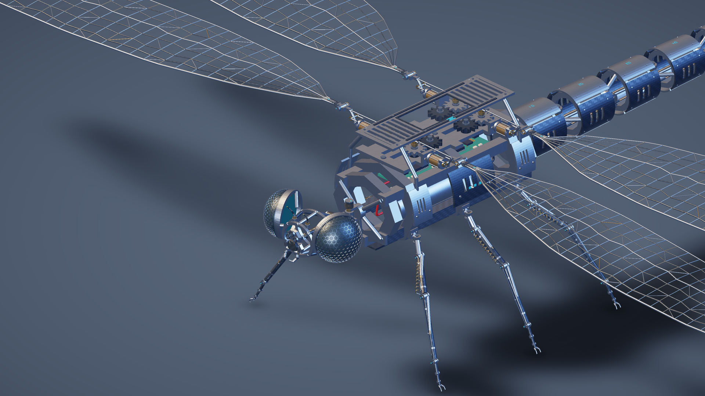

# Mechanical Dragonfly



Mechanical Dragonfly is a procedural 3D model and simulation project built in Python. It combines a detailed biomimetic assembly with textured materials, articulated animation, approximate flight physics, an interactive control studio, and cinematic rendering. The geometry is generated without Blender.

The project is a visual engineering concept. Its flight model is approximate; the dragonfly is not a manufactured or flight-tested robot.

## Explore the project

- **Model:** A 255.7 mm body with a 400.2 mm wingspan, four wings, six legs, compound eyes, and an articulated abdomen.
- **Motion:** Independent wing, head, abdomen, and leg controls, plus animated flight sequences.
- **Materials:** Procedural metal, carbon, optical, and wing textures.
- **Control studio:** A local browser interface for viewing the assembly, adjusting its pose, and exporting images, models, and flight telemetry.
- **Rendering:** Native EGL/OpenGL still images and FFmpeg video export, including the Last Flight scenario.

## Run locally

Requires Python 3 and Linux for the native EGL renderer. FFmpeg is needed for MP4 export.

```bash
python3 -m venv .venv
source .venv/bin/activate
python -m pip install -r requirements.txt
python main.py
```

`python main.py` generates the default assembly. Use `python main.py --stage 15 --output models/dragonfly.glb` for an explicit output path. For available options, run `python main.py --help`.

To open the control studio:

```bash
python app/server.py
```

To render a short cinematic preview after obtaining the required model asset:

```bash
python cinematic/generate_realistic.py --preview --width 640 --height 360 --fps 12 --output renders/preview.mp4
```

Generated GLB models and videos are excluded from Git. A fresh clone needs additional model assets for the control studio and cinematic scripts. See [asset setup](docs/ASSETS.md) for the required filenames and [cinematic notes](cinematic/README_V2.md) for rendering options. The EGL renderer has been validated locally with Mesa; NVIDIA GPU and Kaggle rendering have not yet been validated.

## Project layout

| Directory | Contents |
| --- | --- |
| `components/` | Parametric geometry for the body, wings, eyes, transmission, and legs |
| `materials/`, `textures/` | Material generation and texture maps |
| `simulation/` | Articulation and approximate flight physics |
| `rendering/`, `cinematic/` | OpenGL rendering, scenes, and video generation |
| `app/` | Interactive browser control studio |
| `scenarios/` | Cinematic scenario definitions |
| `tests/` | Geometry, animation, simulation, and rendering checks |
| `docs/` | Design and implementation details |

## Documentation

See the [project roadmap](docs/ROADMAP.md), [control studio guide](docs/STEP_29.md), [cinematic guide](docs/STEP_30.md), and [asset setup](docs/ASSETS.md). To run the regression suite, use `python run_tests.py`.
